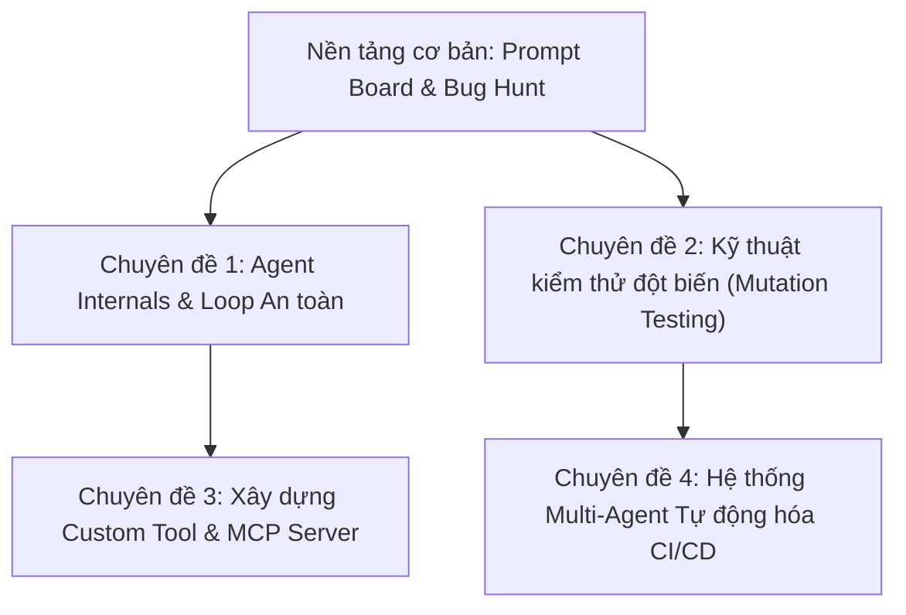

# 01. ĐÁNH GIÁ SƯ PHẠM, KHẢ NĂNG TIẾP THU & CHIẾN LƯỢC MỞ RỘNG
> Bản phân tích toàn diện dựa trên tài liệu gốc Course 4 (Stanford CS146S) và thực nghiệm từ 3 nguồn src 1, src 2, src 3.

---

## 1. PHƯƠNG PHÁP ĐÀO TẠO: TRAINING THẾ NÀO?

### 1.1. Triết lý "Build-First" (Lấy sản phẩm làm trung tâm)
Khóa học không dạy ngữ pháp lập trình chay, cũng không dạy lý thuyết AI hàn lâm. Mục tiêu cốt lõi là biến AI thành một **Lập trình viên đồng hành (Pair Programmer)** dưới sự giám sát của học viên.
Học sinh đóng vai trò **"Kỹ sư trưởng / Quản lý dự án"**:
1. Lên đặc tả yêu cầu rõ ràng (Spec / PRD).
2. Thiết lập bối cảnh cho AI (Context Engineering).
3. Yêu cầu AI lập kế hoạch trước khi viết code (Plan $\rightarrow$ Build $\rightarrow$ Verify).
4. Kiểm chứng bằng kiểm thử tự động (TDD) và đọc hiểu thay đổi (Git Diff).

### 1.2. Lựa chọn khung thời gian: 10 buổi × 120' hay 20 buổi × 90'?

| Tiêu chí | Khung 10 buổi × 120 phút | Khung 20 buổi × 90 phút (Khuyên dùng cho người mới) |
| :--- | :--- | :--- |
| **Đối tượng** | Sinh viên CNTT đã vững Git, JavaScript, cơ bản React. | Học sinh phổ thông, sinh viên năm 1, người mới bắt đầu. |
| **Cường độ** | Nhịp cố định: 20' Concept $\rightarrow$ 70' Lab $\rightarrow$ 20' Demo $\rightarrow$ 10' Exit. | Nhịp ngắn: 15' Concept $\rightarrow$ 50' Lab $\rightarrow$ 15' Review $\rightarrow$ 10' Phản tư. |
| **Độ dốc tải** | Rất dốc: Buổi 2 làm Fullstack Monorepo; Buổi 4 làm CI/CD + E2E. | Mịn màng: 8 buổi đầu làm JS thuần & LocalStorage, sau đó mới lên API và Agent. |
| **Tâm lý học tập** | Dễ bị quá tải nếu gặp lỗi môi trường ở 30 phút đầu. | Dễ thở, duy trì sự tập trung cao độ trong 90 phút. |

---

## 2. ĐÁNH GIÁ ĐỘ KHÓ: CÁC BÀI CÓ DỄ HIỂU KHÔNG? HỌC ĐƯỢC KHÔNG?

### 2.1. Đánh giá tổng quát
* **Học sinh hoàn toàn học được** nếu có bài tập cầu nối nhẹ nhàng, môi trường không bị lỗi kẹt dependency và có sự đồng hành của trợ giảng (TA).
* **Rủi ro lớn nhất không nằm ở lý thuyết, mà nằm ở môi trường máy tính:**
  1. Máy tính Windows học sinh bị chặn chạy script PowerShell.
  2. Mạng phòng học chậm, học sinh gõ `npm install` kéo dài khiến hết giờ Lab.
  3. Học sinh có thói quen bấm `Accept/Yes` liên tục cho AI chạy mà không đọc mã nguồn sinh ra.

### 2.2. Đánh giá độ khó chi tiết từng chuyên đề

| Chuyên đề | Mức độ hiểu (1–5) | Mức độ thực hành (1–5) | Phân tích điểm nghẽn & Giải pháp |
| :--- | :---: | :---: | :--- |
| **B1: Prompt $\rightarrow$ App chạy được** | ⭐⭐⭐⭐⭐ (5/5) | ⭐⭐⭐ (3/5) | **Nghẽn:** Học sinh mới chưa quen terminal; bài săn AI hallucination dễ bị hụt vì AI trả lời đúng.  👉 **Giải pháp:** Dùng bộ thẻ khẳng định (Bài 3) và starter `01-prompt-board`. |
| **B2: Spec & Ngữ cảnh (PRD/CLAUDE.md)** | ⭐⭐⭐⭐ (4/5) | ⭐⭐⭐⭐ (4/5) | **Nghẽn:** Dựng fullstack (Express + Prisma + React) trong 30' là quá tải.  👉 **Giải pháp:** Dùng starter API hoặc LocalStorage có sẵn, chỉ yêu cầu bổ sung 1 feature. |
| **B3: Plan $\rightarrow$ Build $\rightarrow$ Verify** | ⭐⭐⭐⭐ (4/5) | ⭐⭐⭐ (3/5) | **Nghẽn:** Học sinh lười đọc diff, commit bừa bãi.  👉 **Giải pháp:** Dùng bài `03-diff-review`, cài cắm 9 lỗi để học sinh thấy test xanh vẫn có bug. |
| **B4: Kiểm thử với AI (TDD)** | ⭐⭐⭐ (3/5) | ⭐⭐⭐⭐⭐ (5/5) | **Nghẽn:** AI gian lận test bằng cách sửa assertion cho pass.  👉 **Giải pháp:** Dùng bài `04-test-cheat` và công cụ mutation test để vạch trần test yếu. |
| **B5: Mở rộng Agent (Tool/MCP)** | ⭐⭐⭐ (3/5) | ⭐⭐⭐⭐ (4/5) | **Nghẽn:** Khái niệm Tool calling trừu tượng, nguy cơ mất an toàn.  👉 **Giải pháp:** Dùng bài `05-agent-safety-evals` và `06-agent-loop-lab` có sẵn sandbox. |
| **B6: Săn lỗi & Bảo mật** | ⭐⭐⭐⭐ (4/5) | ⭐⭐⭐ (3/5) | **Nghẽn:** Học sinh hỏi chung chung "sửa code hộ".  👉 **Giải pháp:** Dùng bài `02-api-bug-hunt` bắt buộc viết test tái hiện lỗi trước khi cho AI sửa. |

---

## 3. CHUẨN ĐẦU RA: SAU BUỔI HỌC TIẾP THU ĐƯỢC NHỮNG GÌ?

### 3.1. Chắc chắn đạt được (Với 100% học sinh nếu làm bài lab)
1. **Thay đổi nhận thức về AI:** Hiểu rằng LLM chỉ là mô hình dự đoán từ tiếp theo (*"Tự tin không đồng nghĩa với đúng"*); loại bỏ hoàn toàn tâm lý thần thánh hóa AI.
2. **Kỹ năng tương tác cơ bản:** Biết mở terminal chạy Claude Code CLI / AI tool; biết ngắt khẩn cấp bằng phím `Esc` khi AI đi chệch hướng; biết từ chối lệnh nguy hiểm (`rmdir`, `del`).
3. **Thấy được sự khác biệt có số liệu:** Cùng một bài toán, prompt mơ hồ tạo ra code rác/lỗi; prompt có cấu trúc 5 thành phần (Goal, Context, Schema, Constraints, Verification) tạo ra app chạy ngay.

### 3.2. Đạt được một phần (Cần củng cố qua các buổi tiếp theo)
* **Thói quen đọc `git diff` trước khi bấm duyệt:** Học sinh hiểu lý do cần đọc diff, nhưng vẫn cần TA nhắc nhở thường xuyên trong 3 buổi đầu thì mới thành phản xạ tự nhiên.
* **Tự viết Spec/Constraints chặt chẽ:** Ban đầu học sinh hay viết tính từ cảm tính (*"làm giao diện đẹp, hiện đại"*); sau khi được hướng dẫn sẽ biết đưa ra số đo kỹ thuật (*"tối đa 80 ký tự, không nhận khoảng trắng, không cài thêm thư viện ngoài"*).

### 3.3. Chưa thể kỳ vọng ngay sau Buổi 1
* Chưa thể kỳ vọng học sinh tự viết code React/Node phức tạp từ con số 0 mà không có AI hoặc template.
* Chưa thể kỳ vọng học sinh hiểu sâu về kiến trúc transformer hay chi phí token dưới tầng sâu.

### 3.4. Phương pháp đo lường kết quả thực tế trên lớp (Dưới 5 phút)
1. **Checklist quan sát của TA (Đo trong giờ lab):**
   * $\square$ Học sinh có dừng lại đọc lệnh trước khi bấm chấp nhận không?
   * $\square$ Học sinh có dùng phím `Esc` hoặc từ chối ít nhất 1 lần khi AI làm thừa không?
   * $\square$ Bài lab của học sinh có chạy xanh toàn bộ `npm test` không?
2. **Phiếu học tập Exit Ticket (Đo cuối giờ):**
   * Đặt 1 câu hỏi kiểm tra: *"Hãy chỉ ra 1 quyết định mà AI tự ý thêm vào bài làm của em mà em không yêu cầu? Em đã xử lý điều đó như thế nào?"*.
   * Học sinh nào trả lời cụ thể được tên biến/tính năng chứng tỏ đã thực sự tiếp thu bài học.

---

## 4. CHIẾN LƯỢC MỞ RỘNG DẠY NÂNG CAO (ADVANCED TRACK)

Khi học sinh đã hoàn thành các bài cơ bản, giáo viên có thể mở rộng theo 4 chuyên đề nâng cao:

### 🎯 Chuyên đề 1: Tự lập trình vòng lặp an toàn cho Agent (`06-agent-loop-lab`)
* **Nội dung:** Không chỉ dùng Claude có sẵn, học sinh tự code một vòng lặp Agentic (Think $\rightarrow$ Act $\rightarrow$ Observe) bằng TypeScript/JavaScript.
* **Mục tiêu:** Tự xây dựng "phanh an toàn" cho AI: Chặn path traversal (`../secret.txt`), giới hạn số bước lặp (`maxSteps`), ghi nhật ký audit log.

### 🎯 Chuyên đề 2: Bắt bài AI gian lận test & Đo độ mạnh kiểm thử (`04-test-cheat`)
* **Nội dung:** Cho học sinh quan sát con AI "ăn gian": khi gặp test khó, AI tự sửa assertion hoặc hardcode kết quả trả về `true` để test xanh.
* **Mục tiêu:** Học sinh sử dụng kỹ thuật **Mutation Testing** (tự động biến đổi mã nguồn) để đánh giá độ mạnh của test suite (đạt mutation score 100%).

### 🎯 Chuyên đề 3: Xây dựng Custom Tool & MCP Server (`05-agent-safety-evals`)
* **Nội dung:** Kết nối AI với các hệ thống thực tế thông qua Model Context Protocol (MCP).
* **Mục tiêu:** Học sinh tự viết MCP Server đọc cơ sở dữ liệu SQLite, truy vấn thời tiết, tương tác trình duyệt qua Playwright, và áp dụng bộ kiểm tra bảo mật (Evaluation Harness) để ngăn chặn Prompt Injection.

### 🎯 Chuyên đề 4: Tự động hóa Multi-Agent trong CI/CD GitHub Actions
* **Nội dung:** Thiết lập tổ đội AI hoạt động tự động trên đám mây.
* **Mục tiêu:** Agent 1 sinh code $\rightarrow$ Agent 2 chạy security scan $\rightarrow$ Agent 3 phản biện mã nguồn $\rightarrow$ Tự động tạo báo cáo chất lượng trước khi merge vào nhánh chính.
