# TÀI LIỆU HƯỚNG DẪN SỬ DỤNG BỘ CÔNG CỤ SRC FINAL
## VÀ MỐI LIÊN HỆ ĐỐI CHIẾU VỚI GIÁO TRÌNH GỐC (Course4_ModernAISoftwareDeveloper_Materials)
> **Dành cho:** Ban Đào tạo, Giảng viên đứng lớp và Đội ngũ Trợ giảng Kỹ thuật (TA).  
> **Nguyên tắc bảo mật:** Học sinh chỉ nhận gói `student_kit.zip`. Mọi tài liệu đáp án và giáo án chỉ lưu tại `instructor_and_ta/`.

---

## 1. TỔNG QUAN VỀ GIÁO TRÌNH GỐC VÀ SỰ RA ĐỜI CỦA SRC FINAL

### 1.1. Bản chất giáo trình gốc (`Course4_ModernAISoftwareDeveloper_Materials`)
Giáo trình gốc là khóa học **"The Modern AI Software Developer" (v2 materials)**, được chuyển giao và phỏng theo chương trình danh tiếng **Stanford CS146S** (*The Modern Software Developer*, Fall 2025).
* **Mô hình học:** Build-first, một sản phẩm duy nhất. Nhóm 4–5 người cùng xây dựng một ứng dụng web Fullstack (React 18 + Node.js/TypeScript + SQLite/Prisma) từ Buổi 1 đến Demo Day.
* **Công cụ trung tâm:** Claude Code CLI đóng vai trò Lập trình viên đồng hành (Pair Programmer).
* **Nhịp điệu gốc:** Khung cố định **10 buổi × 120 phút** theo công thức: 20' Concept $\rightarrow$ 70' Lab thực hành $\rightarrow$ 20' Demo & Code Review $\rightarrow$ 10' Exit ticket.

### 1.2. Vì sao cần bộ công cụ `src final`?
Mặc dù giáo trình gốc rất hiện đại và chuẩn công nghiệp, nhưng khi triển khai thực tế cho **"mấy đứa nhóc" (học sinh mới, sinh viên năm đầu hoặc người chưa vững nền tảng)**, giáo trình gốc bộc lộ các rào cản lớn:
1. **Nghẽn mạng và lỗi môi trường:** Dựng Monorepo Fullstack (Vite + React + TypeScript + Prisma) đòi hỏi kéo hàng trăm MB thư viện qua `npm install`. Nếu mạng phòng học yếu hoặc máy Windows bị chặn PowerShell, học sinh sẽ kẹt cứng ngay từ 30 phút đầu.
2. **Quá tải nhận thức:** Buổi 2 của bản gốc bắt học sinh vừa viết PRD, vừa tạo CLAUDE.md, vừa scaffold Fullstack trong 30 phút là quá nặng.
3. **Nguy cơ AI "ăn gian":** Học sinh mới có xu hướng gõ prompt rồi bấm `Accept/Yes` liên tục mà không đọc code diff, hoặc bị AI lừa sửa test assertion cho pass.
4. **Lộ đáp án:** Giáo trình gốc để chung bài tập và hướng dẫn giảng viên trong cùng một cây thư mục.

👉 **Bộ công cụ `src final` ra đời như một "chiếc cầu nối hoàn hảo"**:
* **Zero npm install:** Tất cả bài tập nền tảng chạy trên Node.js tiêu chuẩn (>=20/22) với bộ kiểm thử có sẵn (`node --test`), vào lớp mở máy là chạy ngay.
* **Bảo mật tuyệt đối:** Tách riêng 100% đề bài học sinh (`student_kit`) và lời giải của Thầy (`instructor_and_ta`).
* **Hỗ trợ thực chiến:** Tích hợp cẩm nang cứu hộ lỗi Windows/PowerShell trong 10 giây (từ `src 1`), kịch bản live demo và mutation testing (từ `src 2`), cùng phương án chia nhỏ 20 buổi × 90 phút (từ `src 3`).

---

## 2. BẢN ĐỒ ĐỐI CHIẾU CHI TIẾT GIỮA GIÁO TRÌNH GỐC VÀ SRC FINAL (MAPPING TABLE)

Bảng dưới đây chỉ rõ từng Session của giáo trình gốc tương ứng với tài nguyên nào trong `src final` để Giảng viên và TA phối hợp nhịp nhàng:

| Buổi gốc (Course4 Materials) | Trọng tâm bài dạy gốc | Tài nguyên tương ứng trong `src final` | Giá trị bổ trợ của `src final` |
| :--- | :--- | :--- | :--- |
| **Session 01:** From Prompt to Running App | 5 quy tắc prompt; Vague vs Structured prompt; Hallucination hunt. | • `student_kit/exercises/01-prompt-board`<br>• `instructor_and_ta/02_TA_CLASSROOM_PLAYBOOK.md` (Kịch bản live demo 8') | Cung cấp sẵn web board chạy ngay bằng LocalStorage, không cần mạng; có kịch bản demo phím `Esc` và hộp thoại xin phép. |
| **Session 02:** Context Is Everything | PRD, CLAUDE.md, Scaffold dự án + CRUD. | • `student_kit/exercises/01-prompt-board` (bổ sung tính năng ràng buộc 80 ký tự)<br>• File mẫu `spec.md` & `AGENTS.md` | Giảm tải việc dựng Prisma/TS quá nặng; tập trung vào kỹ năng viết ràng buộc (Constraints) để AI không bịa code. |
| **Session 03:** Plan $\rightarrow$ Build $\rightarrow$ Verify | Kỷ luật đọc diff; Quy trình PR nhỏ; Tránh thay đổi lan man. | • `student_kit/exercises/03-diff-review`<br>• `solutions/03-diff-review` (Pass 10/10 tests) | Cài cắm 9 lỗi logic và bảo mật trong diff (khi test của AI vẫn xanh) để dạy học sinh thói quen đọc diff kỹ lưỡng. |
| **Session 04:** Testing with AI | TDD; E2E Playwright; Bắt bài gian lận test. | • `student_kit/exercises/04-test-cheat`<br>• `solutions/04-test-cheat-honest` & `demo` | Cho học sinh thấy AI tự sửa test để ăn gian; dùng công cụ **Mutation Testing** chứng minh test của AI chỉ đạt 17% điểm độ bền. |
| **Session 05:** Extending Your Agent | Custom commands, Subagents, Model Context Protocol (MCP). | • `student_kit/exercises/05-agent-safety-evals`<br>• `solutions/05-agent-safety-evals` (Pass 15/15 tests) | Bộ kiểm tra an toàn (Evaluation Harness): chặn path traversal, giới hạn tối đa 3 bước lặp, kiểm soát quyền đọc/ghi. |
| **Session 06:** Rapid UI & MVP Checkpoint | Tích hợp giao diện nhanh (v0/Bolt/Lovable), Demo giữa kỳ. | • Giao diện mẫu CSS trong `01-prompt-board`<br>• `01_DANH_GIA_VA_CHIEN_LUOC.md` | Cung cấp tiêu chuẩn UI cơ bản không phụ thuộc framework phức tạp; rubric đánh giá MVP giữa kỳ. |
| **Session 07:** Secure AI Code | Lỗ hổng bảo mật, Semgrep, Prompt Injection. | • `student_kit/exercises/06-agent-loop-lab`<br>• `solutions/06-agent-loop-lab` (Pass 8/8 tests) | Học sinh tự lập trình "phanh an toàn" cho AI: chỉ hỏi khi có tác dụng phụ (side-effect), chặn injection đọc trộm file bí mật. |
| **Session 08:** Code Review & Debugging | Săn lỗi trong app, so sánh Human vs AI review. | • `student_kit/exercises/02-api-bug-hunt`<br>• `solutions/02-api-bug-hunt` (Pass 12/12 tests) | 5 lỗi kinh điển được cài cắm: lỗi phân trang off-by-one, lỗi boolean trong JS, lỗi bảo mật IDOR và rò rỉ bộ nhớ. |
| **Session 09:** Ship It & Incident Drill | Triển khai, giám sát log, diễn tập sự cố production. | • Quy trình xử lý sự cố trong `01_TA_EMERGENCY_CHEATSHEET.md`<br>• Endpoint `/health` kiểm tra hệ thống | Cung cấp quy trình cứu hộ khẩn cấp bằng lệnh `taskkill`, `git restore` và kịch bản ứng phó sự cố. |
| **Session 10:** Demo Day | Báo cáo sản phẩm, vấn đáp cá nhân 5 phút. | • Rubric chấm điểm & Bộ câu hỏi vấn đáp trong `04_DAP_AN_VA_GIAI_THICH_CHI_TIET.md` | Bộ câu hỏi kiểm tra năng lực thật: *"Code bạn không giải thích được thì không phải là code của bạn"*. |

---

## 3. HƯỚNG DẪN QUY TRÌNH VẬN HÀNH THỰC TẾ

```mermaid
flowchart TD
    subgraph GV["GIẢNG VIÊN"]
        A1["Chọn khung giờ: 10 buổi 120' hoặc 20 buổi 90'"] --> A2["Đọc 03_GIAO_AN_VA_KE_HOACH_GIANG_DAY.md"]
        A2 --> A3["Thực hiện Live-Demo 8' theo Playbook"]
        A3 --> A4["Vấn đáp cá nhân theo Rubric tại Demo Day"]
    end
    
    subgraph TA["TRỢ GIẢNG (TA)"]
        B1["Gửi student_kit.zip trước ngày học"] --> B2["Cầm theo 01_TA_EMERGENCY_CHEATSHEET.md"]
        B2 --> B3["Phút 20-30: Rà soát 100% máy chạy `npm test`"]
        B3 --> B4["Phút 50-60: Bắt lỗi bấm Accept mù quáng"]
    end
    
    subgraph HS["HỌC SINH"]
        C1["Nhận và giải nén student_kit.zip"] --> C2["Mở terminal gõ `npm test` (Zero setup)"]
        C2 --> C3["Dùng AI sửa lỗi bài tập đến khi Test xanh"]
        C3 --> C4["Điền Phiếu học tập PHIEU_HOC_TAP.md"]
    end
```



### 3.1. Dành cho Giảng viên đứng lớp
1. **Trước buổi dạy:**
   * Mở file `instructor_and_ta/03_GIAO_AN_VA_KE_HOACH_GIANG_DAY.md` để chọn khung thời lượng phù hợp với lớp:
     * *Khung 10 buổi × 120 phút:* Dành cho lớp sinh viên CNTT đã biết cơ bản Git/JavaScript.
     * *Khung 20 buổi × 90 phút:* Dành cho học sinh phổ thông hoặc người mới bắt đầu từ con số 0.
   * Xem trước các lỗi cài cắm và cách giải thích trong `instructor_and_ta/04_DAP_AN_VA_GIAI_THICH_CHI_TIET.md`.
2. **Trong buổi dạy:**
   * Dành đúng 20 phút đầu cho phần Concept & Live Demo theo kịch bản trong `instructor_and_ta/02_TA_CLASSROOM_PLAYBOOK.md`:
     * Minh họa lệnh xin phép của AI (`hello.js`).
     * Minh họa prompt mơ hồ sinh code rác.
     * Minh họa phím `Esc` để ngắt khẩn cấp.
   * Trong 20 phút cuối buổi: Mời 2 nhóm lên demo (ưu tiên 1 nhóm gặp lỗi thú vị do AI bịa code để cả lớp cùng phân tích).
3. **Đánh giá cuối khóa:** Sử dụng Rubric 4 tiêu chí và Bộ câu hỏi vấn đáp cá nhân tại `04_DAP_AN_VA_GIAI_THICH_CHI_TIET.md` để chấm điểm công bằng.

---

### 3.2. Dành cho Trợ giảng kỹ thuật (TA)
1. **Trước ngày lên lớp (T-2 ngày):**
   * Gửi duy nhất file `src final/student_kit.zip` cho học sinh (qua Zalo/Discord/Google Drive).
   * Yêu cầu học sinh cài đặt trước Node.js bản LTS (v20 hoặc v22) và gõ thử lệnh `node -v` trên Terminal.
   * In sẵn hoặc lưu file `01_TA_EMERGENCY_CHEATSHEET.md` trên điện thoại/tablet.
2. **Trong giờ học:**
   * *10 phút đầu giờ Lab (phút 20–30):* Đi rà soát nhanh qua các bàn. Bảo đảm 100% học sinh đã mở được thư mục bài tập và chạy `npm test`. Nếu máy Windows bị chặn script, áp dụng lệnh:
     ```powershell
     Set-ExecutionPolicy -Scope Process -ExecutionPolicy Bypass
     ```
   * *Giữa giờ Lab (phút 50–60):* Đi tuần tra, quan sát màn hình học sinh. Nếu thấy em nào bấm `Accept/Yes` liên tục mà không đọc diff, đứng lại chất vấn ngay: *"Cho anh/chị xem `git diff`? Lệnh này làm gì?"*.
   * *10 phút cuối giờ:* Phát hoặc nhắc học sinh điền phiếu phản tư `PHIEU_HOC_TAP.md`.

---

### 3.3. Dành cho Học sinh (Cách làm bài thực hành)
1. **Bước 1:** Giải nén `student_kit.zip` vào máy tính.
2. **Bước 2:** Mở Terminal ngay tại thư mục bài tập được giao (ví dụ `exercises/01-prompt-board`).
3. **Bước 3:** Chạy lệnh:
   ```bash
   npm test
   ```
   *(Nhận thông báo lỗi màu đỏ — đây là các yêu cầu bài tập chưa hoàn thành).*
4. **Bước 4:** Bật AI (Claude Code / Copilot / ChatGPT) cùng làm việc, tuân thủ nguyên tắc: Lập kế hoạch $\rightarrow$ Sửa code $\rightarrow$ Kiểm tra `git diff` $\rightarrow$ Chạy lại `npm test` đến khi **toàn bộ test chuyển sang màu xanh**.
5. **Bước 5:** Điền câu trả lời vào [PHIEU_HOC_TAP.md](file:///d:/FPT/project/Course_4/src%20final/student_kit/PHIEU_HOC_TAP.md).

---

## 4. TÓM TẮT LỆNH CỨU HỘ NHANH TRONG 10 GIÂY

| Hiện tượng lỗi | Câu lệnh xử lý tức thì trong Terminal |
| :--- | :--- |
| **PowerShell chặn script** | `Set-ExecutionPolicy -Scope Process -ExecutionPolicy Bypass` |
| **Trùng cổng 3000** | `netstat -ano \| findstr :3000` rồi `taskkill /PID <PID> /F` |
| **Trùng cổng 5173** | `netstat -ano \| findstr :5173` rồi `taskkill /PID <PID> /F` |
| **Cảnh báo Git CRLF** | `git config --global core.autocrlf true` |
| **AI làm hỏng toàn bộ code** | `git restore .` sau đó `git clean -fd` |
| **AI bị đơ hoặc trả lời chậm** | Gõ `/compact` hoặc `/clear` trong Claude CLI |
