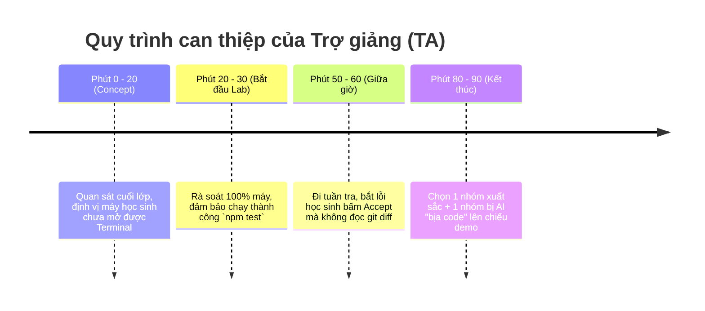

# 🚑 CẨM NANG CỨU HỘ KỸ THUẬT CHO TRỢ GIẢNG (TA EMERGENCY CHEATSHEET)
> **Tài liệu bí kíp mang theo lớp:** Hướng dẫn xử lý 100% các sự cố phổ biến nhất của học sinh (đặc biệt máy Windows) trong vòng 10 giây.

---

## 1. SỰ CỐ WINDOWS & TERMINAL

### ❌ Sự cố 1: PowerShell chặn script (`running scripts is disabled on this system...`)
* **Nguyên nhân:** Chính sách bảo mật mặc định `Restricted` của Windows PowerShell.
* **Lệnh gỡ ngay trong terminal hiện tại (10 giây):**
  ```powershell
  Set-ExecutionPolicy -Scope Process -ExecutionPolicy Bypass
  ```
* **Mẹo lâu dài:** Nếu muốn mở vĩnh viễn cho máy cá nhân của học sinh:
  ```powershell
  Set-ExecutionPolicy -Scope CurrentUser -ExecutionPolicy RemoteSigned
  ```

---

### ❌ Sự cố 2: Trùng cổng (`Error: listen EADDRINUSE: address already in use :::3000` hoặc `:::5173`)
* **Nguyên nhân:** Tiến trình Node.js trước đó bị tắt ngang nhưng chưa giải phóng cổng mạng.
* **Lệnh tìm và diệt tiến trình chiếm cổng ngay lập tức:**
  ```powershell
  # Tìm PID của cổng đang bị chiếm (ví dụ cổng 3000)
  netstat -ano | findstr :3000

  # Diệt ngay tiến trình (thay <PID> bằng số ở cột cuối cùng)
  taskkill /PID <PID> /F
  ```
  *(Nếu trùng cổng 5173 hay 8080, chỉ cần đổi số cổng tương ứng)*

---

### ❌ Sự cố 3: Cảnh báo xuống dòng Git trên Windows (`warning: CRLF will be replaced by LF`)
* **Lệnh khắc phục:**
  ```bash
  git config --global core.autocrlf true
  ```

---

## 2. SỰ CỐ CLAUDE CODE CLI & AI TOOL

### ❌ Sự cố 4: Học sinh bị lỗi đăng nhập hoặc Token hết hạn
* **Lệnh đăng nhập lại:**
  ```bash
  claude /login
  # Kiểm tra phiên bản hiện tại
  claude --version
  ```

---

### ❌ Sự cố 5: AI làm hỏng code, xóa file hoặc sửa lan man
* **Hiện tượng:** Học sinh liên tục bấm `y/Enter`, AI tự ý sinh hàng loạt file lạ hoặc phá vỡ cấu trúc bài tập.
* **Quy trình cứu hộ khẩn cấp 4 bước của TA:**
  1. Nhấn `Ctrl + C` để dừng ngay AI CLI.
  2. Xem những gì AI vừa làm hỏng:
     ```bash
     git status
     git diff
     ```
  3. Hoàn tác sạch sẽ về commit ban đầu trong 5 giây:
     ```bash
     # Hủy toàn bộ thay đổi file
     git restore .
     # Xóa mọi file rác mà AI tự sinh ra
     git clean -fd
     ```
  4. Nhắc học sinh mở lại AI và bắt buộc ra lệnh:
     > *"Hãy lên kế hoạch (Plan) trước từng bước, KHÔNG tự ý chỉnh sửa bất kỳ file nào cho đến khi tôi đồng ý."*

---

### ❌ Sự cố 6: AI trả lời quá chậm hoặc tràn ngữ cảnh (Context Window đầy)
* **Cách xử lý trực tiếp trong cửa sổ Claude CLI:**
  * Gõ `/compact` để nén bớt lịch sử hội thoại trước đó.
  * Hoặc gõ `/clear` để reset sạch ngữ cảnh và bắt đầu bài toán mới.

---

### ❌ Sự cố 7: Cả lớp bị chạm giới hạn Rate Limit (40 máy cùng gọi AI một lúc)
* **Phương án dự phòng:**
  1. Hướng dẫn học sinh tạm thời không gọi AI sinh toàn bộ file, chỉ copy hàm nhỏ cần sửa.
  2. Cho các nhóm dùng chung 1 máy làm đại diện (ghép cặp Pair Programming).
  3. Hoặc chuyển sang dùng giao diện Web Claude/ChatGPT thông thường để sinh code rồi paste về bài tập.

---

## 3. SỰ CỐ CODE & TEST TRONG BÀI TẬP (ZERO NPM INSTALL)

### ❌ Sự cố 8: Gõ `npm test` báo lỗi không tìm thấy `node`
* **Nguyên nhân:** Máy học sinh chưa cài Node.js hoặc chưa cấu hình biến môi trường PATH.
* **Cách kiểm tra nhanh:**
  ```bash
  node -v
  ```
  *Yêu cầu Node >= 20.0.0 hoặc 22.0.0. Nếu chưa có, hướng dẫn tải nhanh Node bản LTS từ nodejs.org.*

---

### ❌ Sự cố 9: Test đỏ lòm ngay khi vừa mở bài
* **Cách giải thích cho học sinh:**
  > *"Test đỏ này là bài tập có chủ đích của thầy, không phải máy bị hỏng! Nhiệm vụ của em là dùng AI đọc file spec và sửa code cho test chuyển sang màu xanh."*

---

## 4. CHIẾN LƯỢC CAN THIỆP CỦA TA THEO TỪNG MỐC GIỜ TRÊN LỚP



* **Phút 0–20 (Concept):** Ngồi ở cuối lớp để quan sát toàn bộ màn hình học sinh. Ai loay hoay chưa mở được màn hình thì lại hỗ trợ nhẹ nhàng không gây ồn.
* **Phút 20–30 (Bắt đầu Lab):** Đi vòng quanh các bàn, đảm bảo **100% học sinh đã mở được terminal và chạy `npm test`**. Bàn nào kẹt thì áp dụng CheatSheet can thiệp ngay trong 3 phút đầu.
* **Phút 50–60 (Giữa giờ):** Đặt câu hỏi kiểm tra: *"Cho anh/chị xem git diff của em? Em có đọc lệnh trước khi bấm Accept không?"*.
* **Phút 80–90 (Tổng kết):** Chọn trước 2 nhóm: 1 nhóm làm bài xuất sắc và 1 nhóm gặp lỗi hài hước do AI bịa code để thầy mời lên chiếu màn hình mổ xẻ bài học.
